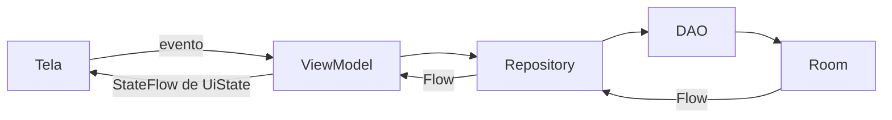

# HabitTracker - Projeto 4

Reorganização do mesmo aplicativo do Trabalho 3 com **MVVM, Repository e Flow**, seguindo o exemplo de Filmes do professor. As 12 telas, os campos, o tema, a navegação e as funcionalidades foram preservados.

## Executar

1. Abra esta pasta no Android Studio compatível com AGP 9.3.2.
2. Configure o JDK 25 para o Gradle e o Android SDK Platform 37, com Build Tools 36.0.0.
3. Sincronize o projeto e execute o módulo `app` em Android API 24 ou superior.

```powershell
.\gradlew.bat :app:assembleDebug
.\gradlew.bat :app:testDebugUnitTest
.\gradlew.bat :app:assembleDebugAndroidTest
```

Em Linux/macOS, use `./gradlew`. A configuração local do SDK fica em `local.properties`, fora do Git.

## Organização

```text
com.example.habittracker/
├── MainActivity.kt
├── data/                    Entity, DAO, Database e conversores
│   └── repository/          Repository por Entity e coordenação de transações
├── viewmodel/               ViewModels, UiStates, formulários e Factories
├── ui/                      Telas, componentes e tema
└── navigation/              Rotas e NavHost existentes
```



- `HabitosViewModel` controla hábitos, formulários, conclusões, foco e configurações.
- `RecompensasViewModel` controla cadastro, edição, exclusão e resgate de recompensas.
- Cada um tem `_uiState` privado, `uiState` público e sua Factory.
- Os quatro DAOs retornam `Flow<List<...>>` em `buscarTodos()`.
- Há um Repository por Entity: Habito, Recompensa, Registro e Perfil.
- As telas coletam o UiState e chamam eventos do ViewModel; não acessam DAOs nem criam coroutines para o banco.

O Room continua sendo a fonte dos dados. A lista muda automaticamente após inserir, atualizar ou remover. O arquivo `habittracker.db`, a versão 2 e a migração 1 -> 2 permanecem. Conclusões, foco e resgates continuam transacionais. Apagar todos os cadastros não recria exemplos na próxima abertura.

O calendário continua demonstrativo, com hoje no dia 15. O foco avança pelos mesmos passos de cinco minutos. A preferência de notificações continua sendo uma simulação.

## Processo, decisões e evidências

- [Documentação do Projeto 4](docs/PROJETO4.md): antes/depois, pacotes, Repository, UiState, problemas encontrados e roteiro de apresentação.
- [Validação desta versão](docs/VALIDACAO_PROJETO4.md): comandos, resultados e limites dos testes.
- [Capturas desta versão](docs/evidencias/projeto4/README.md): imagens do teste de interface no Robolectric, identificadas como simulação.
- [Roteiro de captura em Android](docs/ROTEIRO_DE_EVIDENCIAS.md): percurso e script já existentes para gravar em aparelho.
- [README do Trabalho 3](docs/README_TRABALHO3.md): histórico da versão anterior; os relatórios antigos não validam o Projeto 4.

Para executar em um dispositivo conectado:

```powershell
.\gradlew.bat :app:connectedDebugAndroidTest
.\scripts\testar-persistencia.ps1 -GravarVideo
```

**Antes da entrega:** gravar o vídeo desta versão no aparelho, completar o relato real dos integrantes na documentação e conferir o prazo no Blackboard. Não foram inventados nomes, divisão do trio ou relatos pessoais.
