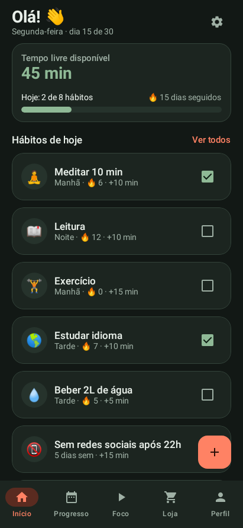

# Evidências do Projeto 4

Estas nove capturas foram produzidas pelo teste `CrudInterfaceLocalTest`, com o Compose real no Android simulado pelo Robolectric (API 35, tela de 411 x 891 dp). Não são imagens de celular nem substituem o vídeo da apresentação.

O percurso testa cadastro, edição e remoção de hábitos e recompensas, progresso, estatísticas, foco, perfil e configurações. Também recria a Activity com o formulário de novo hábito preenchido e verifica que o texto permanece no ViewModel.

- [00-inicio-mvvm.png](00-inicio-mvvm.png)
- [01-habito-adicionado.png](01-habito-adicionado.png)
- [02-habito-editado.png](02-habito-editado.png)
- [03-habito-removido.png](03-habito-removido.png)
- [04-recompensa-editada.png](04-recompensa-editada.png)
- [07-progresso-preservado.png](07-progresso-preservado.png)
- [08-foco-preservado.png](08-foco-preservado.png)
- [09-perfil-preservado.png](09-perfil-preservado.png)
- [10-estatisticas-preservadas.png](10-estatisticas-preservadas.png)

Exemplo da tela inicial:

O vídeo em aparelho precisa usar o APK desta versão. As evidências do Trabalho 3 não comprovam a execução do Projeto 4.
